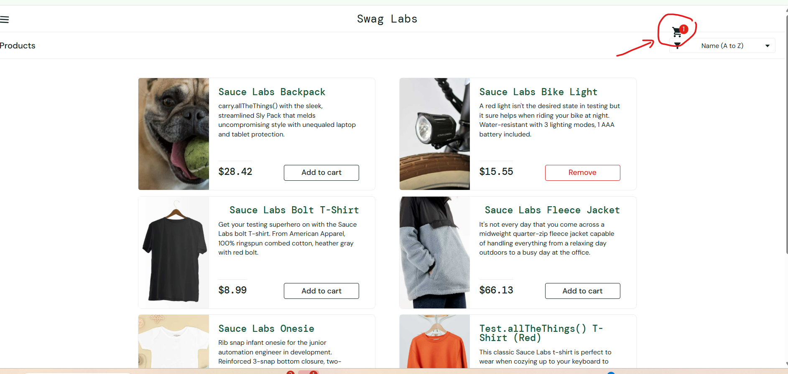

# Bug report

**Summary.** One defect is filed in full (BUG-001: the checkout shows an unformatted, floating-point item total). Four smaller observations from the same exploratory session follow (O-1 to O-4). Every finding has evidence, and those marked *automated* have a test in the `KnownDefect` category that fails until the defect is fixed.

| ID | Title | Severity | Priority | Status |
|---|---|---|---|---|
| [BUG-001](#bug-001-checkout-overview-shows-the-item-total-with-floating-point-noise) | Item total shown as "$59.980000000000004" | Medium | High | Reproduced: manual + automated |
| [O-1](#o-1-a-valid-username-is-marked-as-invalid) | A valid username is marked as invalid | Low | Medium | Reproduced: manual + automated |
| [O-2](#o-2-an-order-can-be-placed-with-an-empty-cart) | An order can be placed with an empty cart | Medium | Medium | Reproduced: manual + automated |
| [O-3](#o-3-login-error-wording) | Login error wording ("Epic sadface") | Trivial | Low | Noted |
| [O-4](#o-4-the-next-user-sees-the-previous-users-cart) | The next user on the same browser sees the previous user's cart | Medium | High | Reproduced: manual + automated |

---

## BUG-001: Checkout overview shows the item total with floating-point noise

| Field | Value |
|---|---|
| **Title** | Checkout overview shows "Item total: $59.980000000000004" instead of "$59.98" |
| **Reported by / date** | Victor Vakareev, 2026-10-21 |
| **Application** | SauceDemo, https://www.saucedemo.com/ (front-end build `assets/index-DnLqFcJI.js`) |
| **Environment** | Windows 11, Chrome 155.0.8059.80 (64-bit); also Playwright Chromium (`CheckoutTotalsTests`) |
| **User** | `standard_user` |
| **Area** | Checkout → Step two: Overview → price summary |
| **Severity / priority** | **Medium / High** (rationale below) |
| **Reproducibility** | Always with the cart below: 3/3 manual attempts plus the automated test. Other carts may or may not show it, depending on their prices and the order the items were added in |

### Steps to reproduce

1. Open https://www.saucedemo.com/ in a new browser session.
2. Log in as `standard_user` with the password shown on the login page.
3. Click **Add to cart** for **Sauce Labs Bike Light** ($9.99).
4. Click **Add to cart** for **Sauce Labs Fleece Jacket** ($49.99).
5. Open the cart and click **Checkout**.
6. Enter First name `Ada`, Last name `Lovelace`, Postal code `1000`, click **Continue**.
7. Look at the price summary on **Checkout: Overview**.

### Expected vs actual

| | Expected | Actual |
|---|---|---|
| Item total | `$59.98` | **`$59.980000000000004`** |
| Tax | `$4.80` | `$4.80` |
| Total | `$64.78` | `$64.78` |

Only **Item total** is wrong; Tax and Total are correct and correctly formatted.

### Evidence

- Automated reproduction: [`CheckoutTotalsTests.Item_total_is_shown_as_a_two_decimal_amount`](src/SauceDemo.UiTests/Tests/CheckoutTotalsTests.cs) (`KnownDefect`).
- Run of 2026-10-21, failing as expected: `Locator expected to have text 'Item total: $59.98' But was: 'Item total: $59.980000000000004'` ([log](docs/evidence/known-defects-run-2026-10-21.txt)).

### Same defect, other carts

| Cart, in the order added | Item total shown | Tax / Total | Evidence |
|---|---|---|---|
| Bike Light, Fleece Jacket | **$59.980000000000004** | $4.80 / $64.78 | [screenshot](docs/bug-001-item-total.png) |
| Onesie, Fleece Jacket | **$57.980000000000004** | $4.64 / $62.62 | [screenshot](docs/bug-001-onesie-fleece.png) |
| Fleece Jacket, Bike Light, Backpack, Bolt T-Shirt | $105.96 (correct) | $8.48 / $114.44 | [screenshot](docs/bug-001-four-items-fleece-added-first.png) |
| Bike Light, Backpack, Bolt T-Shirt | $55.97 (correct) | $4.48 / $60.45 | [screenshot](docs/bug-001-three-items-clean.png) |

> **Retest note.** The same products can show the defect or not, depending on the order they were added. The four products in row 3 show `$105.96` with the Fleece Jacket added first, but `$105.96000000000001` when added as Backpack, Bike Light, Bolt T-Shirt, Fleece Jacket. One clean-looking cart proves nothing; retest with rows 1–2.

**Tax and Total are correct for every cart.** Tax = Item total × 8%, rounded to cents; Total = Item total + Tax. That holds in the four screenshots and in a replay of the site's calculation over every combination and order of the 6 products (1,956 carts), compared with exact decimal arithmetic: [`PriceSummaryArithmeticTests`](src/SauceDemo.UiTests/Tests/Unit/PriceSummaryArithmeticTests.cs). The same replay shows a noisy Item total for 556 of the 1,956 carts. The 8% rate isn't stated on the site; it's inferred from the numbers and should be confirmed with the product owner.

### Likely cause (not verified in the source repository)

The item total is the raw sum of the prices as JavaScript numbers (`9.99 + 49.99 = 59.980000000000004` in IEEE 754 floating point), rendered without formatting. Tax and Total go through `toFixed(2)`, which is why they look right. Fix: keep amounts in integer cents or a decimal type, and format every displayed amount the same way (for example `Intl.NumberFormat` with a currency).

### Severity and priority rationale

- **Severity: Medium.** The order can still be placed and the amount charged (Total) is right, so it's not a functional blocker or data loss. But the customer sees a wrong-looking amount at the moment they confirm a payment.
- **Priority: High.** It's on the page every buyer sees, it's always reproducible with a known cart, and it damages trust exactly where the purchase decision is made. It also points to a wider problem: money handled as floating point. In a financial system the same pattern causes rounding and reconciliation errors, so the fix should cover how amounts are calculated, not only how they're displayed. The fix is small and low-risk.

### Suggested regression tests

- The price summary shows exactly two decimals for every pair of products, in both add orders (data-driven; see `AdditionalTestCases.feature`, rule "Amounts are shown and calculated exactly").
- Item total = sum of line prices; Tax = round(Item total × 8%, 2); Total = Item total + Tax.

---

## Other observations from the same session

### O-1: A valid username is marked as invalid

Log in with a valid username and an **empty password**. The message says only "Password is required", but **both** fields get the red error style and ✖ icon, including the correctly filled username. The user is told that a valid field is wrong, and screen-reader users get no hint of which field failed.

- **Severity / priority:** Low / Medium (usability, accessibility).
- **Evidence:** [screenshot](docs/o-1-o-3-login-error.png); [`LoginFormTests.Only_the_missing_field_is_marked_as_invalid`](src/SauceDemo.UiTests/Tests/LoginFormTests.cs) fails with the username field's class `input_error form_input error` ([log](docs/evidence/known-defects-run-2026-10-21.txt)).

### O-2: An order can be placed with an empty cart

With an **empty cart**, Checkout is enabled and the order can be finished: Overview shows "Item total: $0", then "Thank you for your order!". This is the edge case in `ManualTestCases.feature`.

- **Severity / priority:** Medium / Medium. An empty order creates a confirmation with nothing behind it.
- **Evidence:** [screenshot](docs/o-2-empty-cart-order-complete.png); [`SessionAndCartTests.Checkout_is_not_offered_for_an_empty_cart`](src/SauceDemo.UiTests/Tests/SessionAndCartTests.cs) fails with `Locator expected to be disabled`: the button is enabled ([log](docs/evidence/known-defects-run-2026-10-21.txt)).

### O-3: Login error wording

Login errors start with "Epic sadface:". Fine for a demo site; for a real product, especially in financial services, the wording should be neutral ("Password is required"), optionally with an icon.

- **Severity / priority:** Trivial / Low.
- **Evidence:** [screenshot](docs/o-1-o-3-login-error.png).

### O-4: The next user sees the previous user's cart

1. Log in as `standard_user` and add a product to the cart (the automated test uses **Sauce Labs Backpack**; the screenshot used **Sauce Labs Bike Light**).
2. Log out from the menu.
3. Log in as `visual_user` on the same browser.

**Expected:** the new user starts with an empty cart. **Actual:** the cart badge shows `1`, and the previous user's product is still in the cart, with its button showing **Remove**.

The cart is stored in the browser (`localStorage`, key `cart-contents`) rather than per user, and Logout clears only the session. On a shared or public computer, one person's selections reach the next person.

- **Severity / priority:** Medium / High. It's a data-isolation issue between users, which a regulated application treats as a security finding, not a cosmetic one.
- **Evidence:** [`SessionAndCartTests.Next_user_on_the_same_browser_does_not_see_the_previous_users_cart`](src/SauceDemo.UiTests/Tests/SessionAndCartTests.cs) fails with `Locator expected to have count '0' But was: '1'` on the cart badge ([log](docs/evidence/known-defects-run-2026-10-21.txt)).

*Screenshot as `visual_user` after `standard_user` logged out: badge `1`, Bike Light shows "Remove". The unusual prices and the shifted cart icon in this screenshot are `visual_user`'s deliberate visual defects (it's a test persona for visual testing), not part of O-4.*
