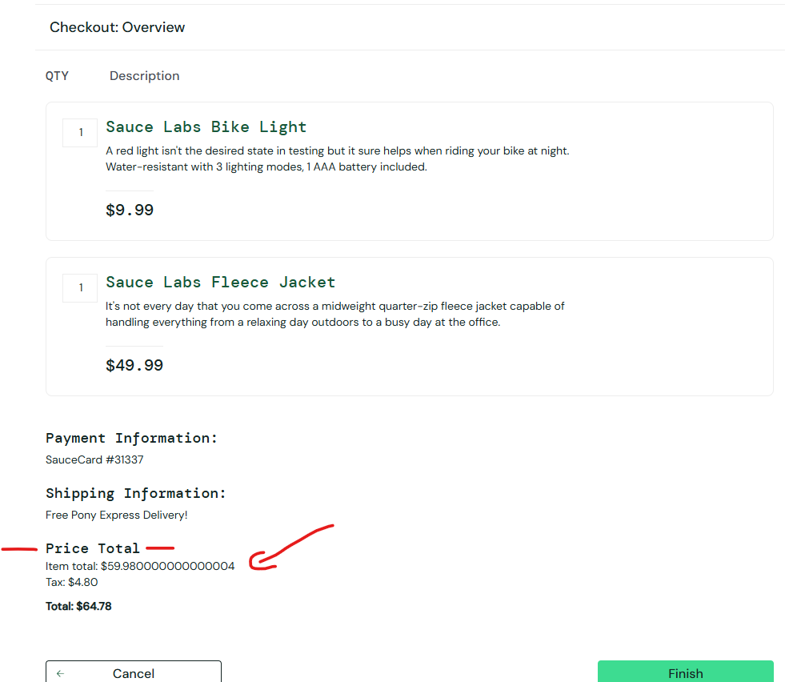

# Bug report

## BUG-001: Checkout overview shows the item total with floating-point noise ("$59.980000000000004")

| Field | Value |
|---|---|
| **ID** | BUG-001 |
| **Title** | Checkout overview shows "Item total: $59.980000000000004" instead of "$59.98" |
| **Reported by / date** | Victor Vakareev, 2026-10-21 |
| **Application** | SauceDemo, https://www.saucedemo.com/ (build `assets/index-DnLqFcJI.js`) |
| **Environment** | Windows 11, Chrome `155.0.8059.80 (Official Build) (64-bit)`; also reproduced with Playwright Chromium (`CheckoutTotalsTests`) |
| **User** | `standard_user` |
| **Area** | Checkout → Step two: Overview → price summary |
| **Severity** | **Medium** |
| **Priority** | **High** |
| **Reproducibility** | Always with the cart below (3/3 manual attempts, plus the automated test). Other carts may or may not show it, depending on their prices and the **order** the items were added in (see "Same defect, other carts") |

### Steps to reproduce

1. Open https://www.saucedemo.com/ in a new browser session.
2. Log in as `standard_user` with the password shown on the login page.
3. Click **Add to cart** for **Sauce Labs Bike Light** ($9.99).
4. Click **Add to cart** for **Sauce Labs Fleece Jacket** ($49.99).
5. Open the cart and click **Checkout**.
6. Enter First name `Ada`, Last name `Lovelace`, Postal code `1000`, click **Continue**.
7. Look at the price summary on **Checkout: Overview**.

### Expected result

Amounts are shown as currency with two decimals:

```
Item total: $59.98
Tax: $4.80
Total: $64.78
```

### Actual result

```
Item total: $59.980000000000004
Tax: $4.80
Total: $64.78
```

Tax and Total are correct and correctly formatted; only **Item total** is wrong.

### Evidence



- Screenshot: [`docs/bug-001-item-total.png`](docs/bug-001-item-total.png)
- Automated reproduction: `src/SauceDemo.UiTests/Tests/CheckoutTotalsTests.cs` (`Item_total_is_shown_as_a_two_decimal_amount`, category `KnownDefect`; fails until the bug is fixed).
- Automated run 2026-10-21, failing as expected: `Locator expected to have text 'Item total: $59.98' But was: 'Item total: $59.980000000000004'` (log: [`docs/evidence/known-defects-run-2026-10-21.txt`](docs/evidence/known-defects-run-2026-10-21.txt)).

### Same defect, other carts

| Cart (in the order added) | Item total shown | Tax / Total shown | Evidence |
|---|---|---|---|
| Bike Light, Fleece Jacket | **$59.980000000000004** | $4.80 / $64.78 | [`bug-001-item-total.png`](docs/bug-001-item-total.png) |
| Onesie, Fleece Jacket | **$57.980000000000004** | $4.64 / $62.62 | [`bug-001-onesie-fleece.png`](docs/bug-001-onesie-fleece.png) |
| Fleece Jacket, Bike Light, Backpack, Bolt T-Shirt | $105.96 (correct) | $8.48 / $114.44 | [`bug-001-four-items-fleece-added-first.png`](docs/bug-001-four-items-fleece-added-first.png) |
| Bike Light, Backpack, Bolt T-Shirt | $55.97 (correct) | $4.48 / $60.45 | [`bug-001-three-items-clean.png`](docs/bug-001-three-items-clean.png) |

**Not every cart shows the defect, and the same products can show it or not depending on the order they were added.** The four products in row 3 display `$105.96` when the Fleece Jacket is added first. Added as Backpack, Bike Light, Bolt T-Shirt, Fleece Jacket, the floating-point sum is `105.96000000000001`. A retest with one "clean" cart therefore proves nothing; retest with the carts in rows 1–2.

**Tax and Total are correct in every case checked.** Tax = Item total × 8%, rounded to cents; Total = Item total + Tax. That holds in all four screenshots, and in a replay of the site's calculation over every combination and order of the 6 products (1,956 carts), compared with exact decimal arithmetic: [`PriceSummaryArithmeticTests`](src/SauceDemo.UiTests/Tests/Unit/PriceSummaryArithmeticTests.cs) (run with `dotnet test --filter TestCategory=Unit`). The same replay shows the noisy Item total for 556 of the 1,956 carts. The 8% rate itself isn't stated anywhere on the site; it's inferred from the numbers and should be confirmed with the product owner.

### Likely cause (for the developer, not verified in the source repository)

The item total is the raw sum of the prices as JavaScript numbers (`9.99 + 49.99 = 59.980000000000004` in IEEE 754 floating point) and is rendered without formatting. Tax and Total go through `toFixed(2)`, which is why they look right. A fix is to keep amounts in integer cents or a decimal type and format every displayed amount the same way (e.g. `Intl.NumberFormat` with currency).

### Severity and priority rationale

- **Severity: Medium.** The order can still be placed and the amount charged (Total) is right, so it's not a functional blocker or data loss. But the customer sees a wrong-looking financial amount at the moment they confirm a payment.
- **Priority: High.** It's on the checkout page every buyer sees, it's always reproducible with a known cart, it damages trust exactly where the purchase decision is made, and it hints at a wider problem: money handled as floating point. In a financial system the same pattern can cause rounding and reconciliation errors, so the fix should cover how amounts are calculated, not only how they're displayed. The fix is small and low-risk.

### Suggested regression tests

- The price summary for every pair of catalogue products, in both add orders, shows exactly two decimals (data-driven over the catalogue).
- Item total = sum of line prices; Tax = round(Item total × 8%, 2); Total = Item total + Tax.

---

## Other observations from the same session (not filed as the main bug)

| ID | Observation | Severity / priority | Status / evidence |
|---|---|---|---|
| O-1 | Login with a valid username and an **empty password**: the error says only "Password is required", but **both** fields get the red error style and ✖ icon, including the correctly filled username. The user is told that a valid field is wrong. Covered by `LoginFormTests.Only_the_missing_field_is_marked_as_invalid` (`KnownDefect`); the 2026-10-21 run shows the username field with class `input_error form_input error`. | Low / Medium (usability, accessibility) | Reproduced (manual + automated): [`o-1-o-3-login-error.png`](docs/o-1-o-3-login-error.png) |
| O-2 | With an **empty cart**, Checkout is still enabled and the order can be finished: Overview shows "Item total: $0", then "Thank you for your order!" (see the edge case in `ManualTestCases.feature`). | Medium / Medium | Reproduced (manual): [`o-2-empty-cart-order-complete.png`](docs/o-2-empty-cart-order-complete.png) |
| O-3 | Login errors start with "Epic sadface:". Fine for a demo site; for a real product, especially in financial services, the wording should be reviewed: a neutral message ("Password is required"), optionally with an icon instead of the phrase. | Trivial / Low | Noted: [`o-1-o-3-login-error.png`](docs/o-1-o-3-login-error.png) |
