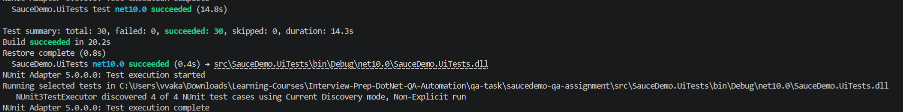

# SauceDemo QA assignment: manual tests, bug report and Playwright UI automation (C#)

Solution to the QA Engineer homework on [SauceDemo](https://www.saucedemo.com/).

| Part | Deliverable |
|---|---|
| 1. Manual testing | [`ManualTestCases.feature`](ManualTestCases.feature): positive, two negative and one edge-case scenario in Gherkin |
| 2. Exploratory testing | [`BugReport.md`](BugReport.md): BUG-001 plus other observations from the session |
| 3. UI automation | [`src/SauceDemo.UiTests`](src/SauceDemo.UiTests): Playwright for .NET + NUnit |
| More time | [`IMPROVEMENTS.md`](IMPROVEMENTS.md): what I'd add next |

## Run it

Needs the [.NET 10 SDK](https://dotnet.microsoft.com/download). Nothing else: the first run installs the Playwright browser.

```powershell
git clone <this repo>
cd saucedemo-qa-assignment
dotnet test --filter "TestCategory!=KnownDefect"      # what CI runs
```

| Command | What it does |
|---|---|
| `dotnet test --filter "FullyQualifiedName~PurchaseFlowTests"` | Only the assignment scenario |
| `dotnet test --filter "TestCategory=Unit"` | Parser unit tests, no browser |
| `dotnet test --filter "TestCategory=KnownDefect"` | Tests that reproduce the reported bugs (expected to fail) |
| `$env:HEADED="1"; dotnet test ...` | Watch the browser |
| `$env:BROWSER="firefox"; dotnet test ...` | Another browser (`chromium`, `firefox`, `webkit`) |

Local run (Windows, .NET 10, Chromium): 21 tests passed, known defects excluded; the scenario logs each step.



When a UI test fails, a Playwright trace is saved under `bin/<config>/net10.0/playwright-traces/` and attached to the test result. Open it with `pwsh bin/Debug/net10.0/playwright.ps1 show-trace <file>` or at [trace.playwright.dev](https://trace.playwright.dev).

## Credentials: "prone to change"

No user name or password is stored in the repository. `CredentialsProvider` resolves them at runtime:

1. **Environment variables** `SAUCEDEMO_USERNAME` and `SAUCEDEMO_PASSWORD`, if both are set (for example from CI secrets, or for another environment).
2. Otherwise, **the hints SauceDemo publishes on its login page** ("Accepted usernames are: …", "Password for all users: …"), read by the test before logging in. The wanted user (`standard_user`, from `appsettings.json`) is picked from that list; if it was renamed, the only listed user with the same prefix is used; if it's missing, the test fails with a message listing the available users.

So a changed password or user name on the site needs no code change. The parsing is unit-tested (`ParsingTests`), and `Credentials.ToString()` never prints the password.

## The automated scenario

`PurchaseFlowTests.Standard_user_completes_an_order_after_changing_the_cart`, as named steps:

| Step | What's checked |
|---|---|
| 1–2. Log in | Credentials resolved as above; "Products" page shown |
| 3. Highest and lowest price | Found **from the prices on the page**, not hard-coded; cart badge 2; cart lists exactly those two |
| 4. Remove the highest | Cart lists only the lowest; badge 1 |
| 5. Sort Name (A to Z), add the last | The list is actually in A–Z order; the last product is added; badge 2 |
| 6. Checkout | Cart lists the lowest + last product; customer data from `TestData/checkout-customer.json` |
| 7. Finish | Overview lists the same two; item total = sum of prices; total = item total + tax |
| 8. Order placed | "Thank you for your order!" and the `checkout-complete` URL |
| 9. Cart empty | No badge; the cart page has no items |
| 10. Log out | Login form shown; `/inventory.html` is refused afterwards (the session really ended) |

Extra tests:

- `LoginFormTests`: required fields, wrong password, locked-out user, dismissing the error, masked password.
- `CheckoutTotalsTests`: reproduces BUG-001.
- `ParsingTests`: credentials and money parsing.

## Design

```
src/SauceDemo.UiTests/
  Config/          settings (appsettings.json + env overrides), credentials provider and parser, test data loader
  Pages/           page objects: Login, Inventory, Cart, Checkout (3 steps), Header (cart + menu)
  Models/          Product, money parsing
  Infrastructure/  UiTestBase (context options, timeouts, trace on failure), browser install fixture
  Tests/           PurchaseFlowTests, LoginFormTests, CheckoutTotalsTests, Unit/ParsingTests
  TestData/        checkout-customer.json
```

- **Page objects return the next page** (`cart.CheckoutAsync()` returns the information page), so the test reads like the user journey and the compiler stops impossible flows.
- **Locators use `data-test` attributes** (stable, made for testing) and accessible roles for buttons ("Add to cart", "Remove"), all kept inside page objects. Products are found by their exact name, never by position.
- **Playwright's web-first assertions** (`Expect(...).ToHaveTextAsync`) wait for the UI, so there are no sleeps.
- **Each test gets a new browser context**: no shared cart or login state between tests, which also makes them safe to run in parallel.
- **Configuration, test data and secrets are separate from code**: base URL and timeouts in `appsettings.json`, customer data in `TestData/`, credentials from env or the page.
- **Known defects are tests too**, in the `KnownDefect` category: they document the bug and turn green when it's fixed, without blocking the pipeline meanwhile.

## CI

`.github/workflows/ui-tests.yml` runs on every push and pull request, in two jobs:

- **test** (the gate): build, install Chromium, `dotnet test` without known defects, upload TRX results and any failure traces.
- **known-defects** (never blocks, `continue-on-error`): runs the tests that reproduce the reported bugs and uploads their results and Playwright traces as the `known-defect-evidence` artifact.

The last local run of the known defects (both failing as expected) is in [`docs/evidence/`](docs/evidence/). Trace files stay out of git (`.gitignore`): they're regenerated by every run and include everything typed into the page.

## Assumptions

- Step 3 treats "highest" and "lowest" as unique prices (true for the current catalogue; the test asserts they differ).
- Step 5 assumes the last product A–Z isn't already in the cart (the test asserts it, so a catalogue change gives a clear failure instead of a confusing one).
- Gherkin scenarios are manual test design only, as the assignment asks; they aren't bound to Reqnroll.
